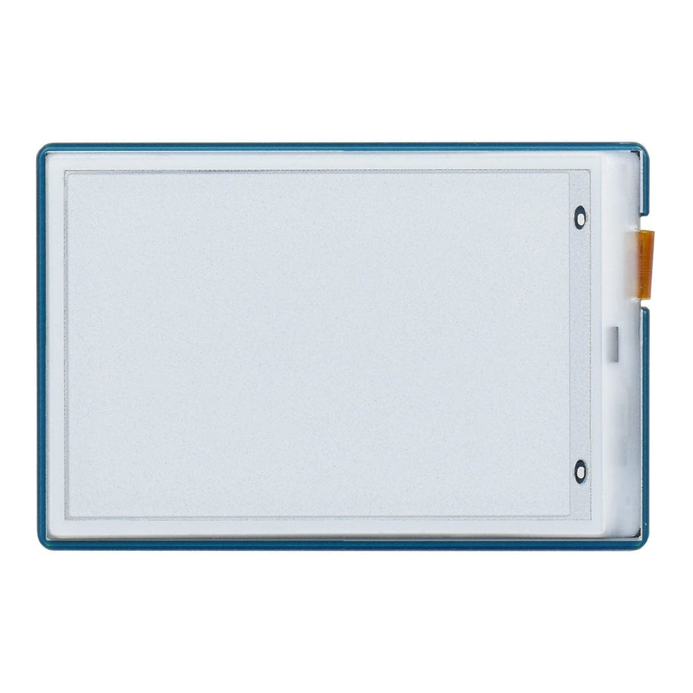
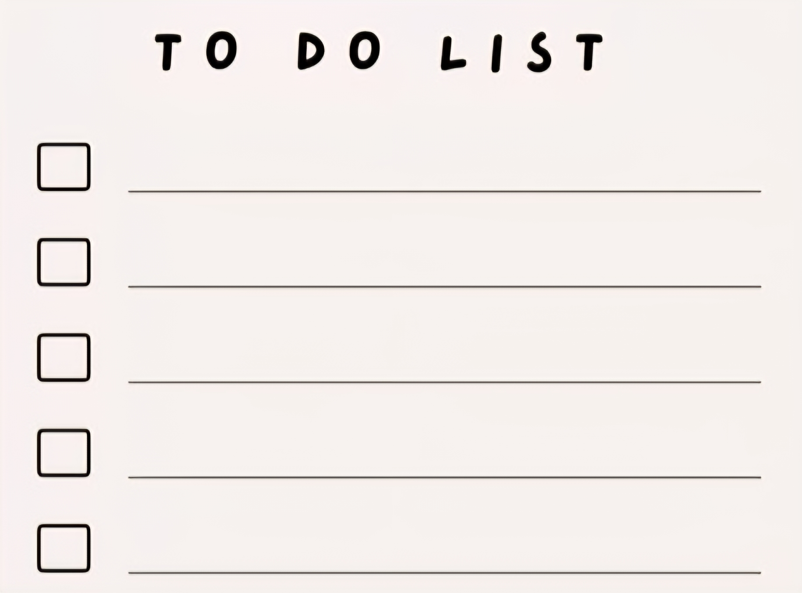
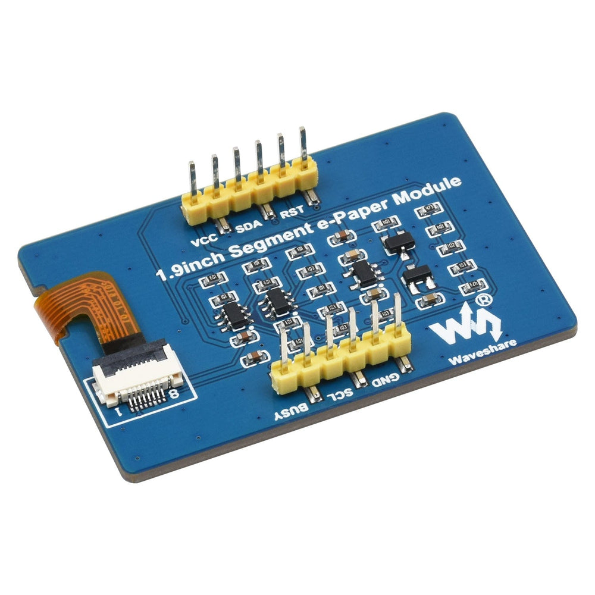
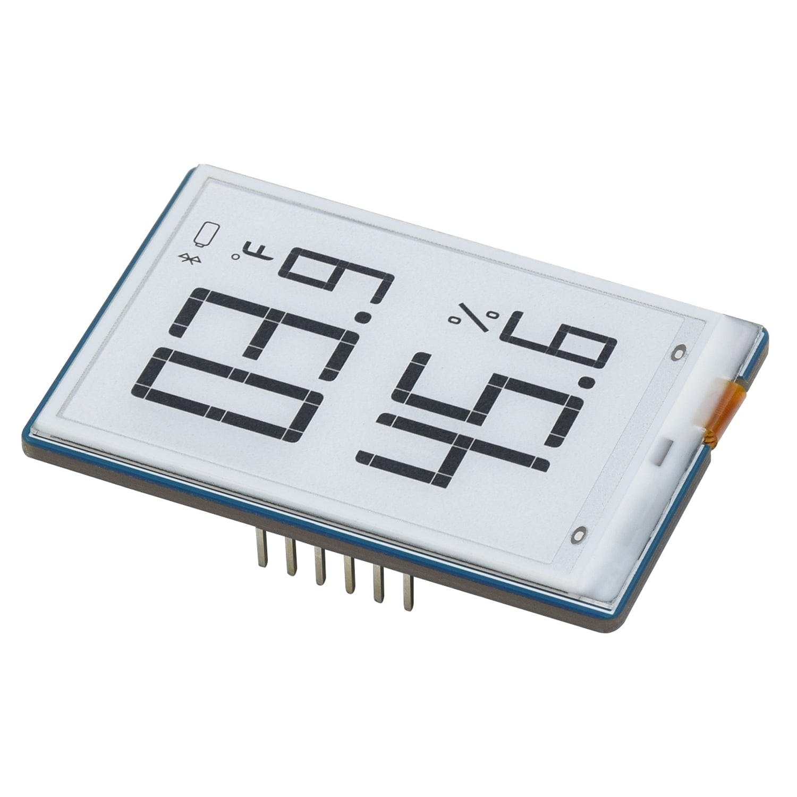
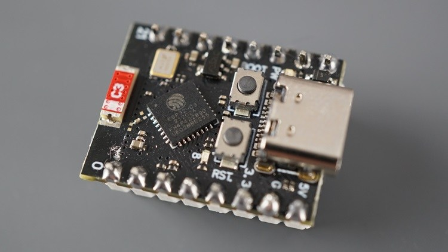
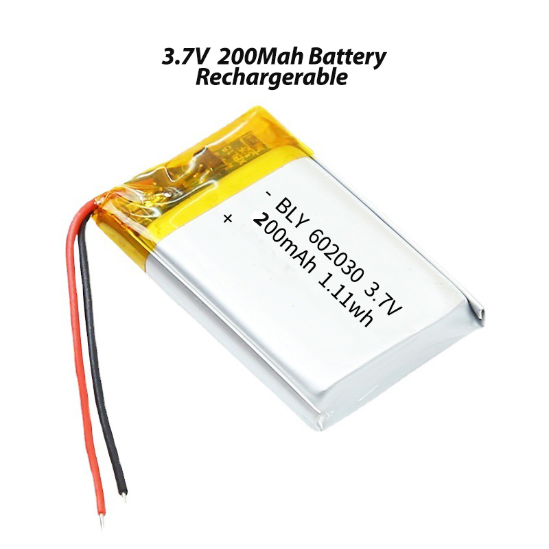
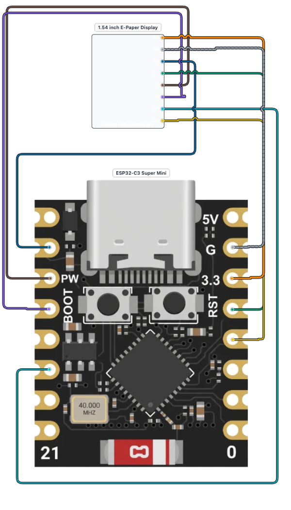
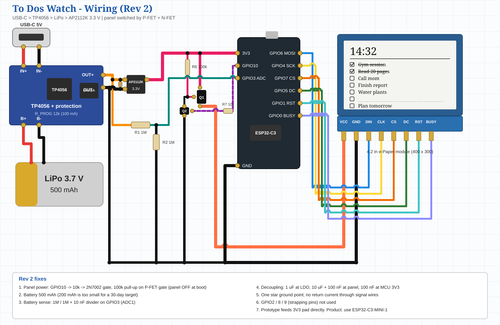

# ToDos-Watch: A Paper-Ink Watch That Shows Your To-Dos

<p align="center">
  
  
</p>

A smartwatch with an e-paper (paper-ink) display that shows the time and your daily to-do list. You create and tick tasks in a web app on your phone, and the changes reach the watch over Bluetooth Low Energy (BLE). The display keeps working even when the phone is not connected.

## 1. Project gallery

### Front and back

<p align="center">
  
  
</p>

### Side view

<p align="center">
  
</p>

### Display UI

<p align="center">
  
</p>

### Core components

<p align="center">
  
  
</p>

## 2. Requirements

### 2A. Functional

| ID | Requirement | Status |
|---|---|---|
| F1 | Show the time, fetched in real time from the phone over Bluetooth | Implemented (`TIME:` command) |
| F2 | Create up to 7 to-dos on the phone and show them on the e-paper display | Watch side implemented (`LIST:`); web app needs alignment |
| F3 | Ticking a to-do in the web app crosses it out on the watch | Watch side implemented (`DONE:`); web app needs alignment |
| F4 | Each to-do expires 1 day after creation | Enforced on completion (`410:EXPIRED`); not yet hidden on the display |
| F5 | Show a default quote when no to-do is set | Implemented (4 built-in quotes) |

### 2B. Non-functional

| ID | Requirement | How it is addressed | Status |
|---|---|---|---|
| N1 | Scale to 10k+ to-dos | Full list kept in the web app; only the 7 active slots go to the watch | Partial (no backend yet) |
| N2 | Availability: the watch keeps showing time when sync fails | Clock is computed on the watch from the last `TIME:` sync using `millis()` | Implemented |
| N3 | Availability: users create, edit, and complete to-dos offline | The web app works offline; changes are queued locally and sent on reconnect | Partial (queue not yet built) |
| N4 | Time fetch within about 1 s (4 s acceptable) | One BLE write per sync | Met in principle; needs hardware test |
| N5 | To-do set and cross-off within 200 ms | The BLE acknowledgement can meet 200 ms. The e-paper panel takes about 2 s to refresh, so the visible change is slower | Partly met (display limit) |


## 3. Entities

- **User:** creates, edits, and ticks to-dos from a phone.
- **To-Dos Watch:** the e-paper device. It holds up to 7 active tasks, computes the clock, and shows quotes.
- **Web app:** runs in Chrome or Edge, connects to the watch over Web Bluetooth, and stores the full to-do list.


## 4. API design

| Endpoint | Purpose |
|---|---|
| `GET /v1/data/{timeID}` | Returns the active to-do for that time, or a default quote |
| `POST /v1/todos/{todosID}` | Body `{date, todos: [7]}`. Creates 7 to-dos, each expiring 24 h after creation |
| `POST /v1/todos/completion/{todosID}` | Marks a to-do complete. Returns `410 Gone` if it has expired |
| `GET /v1/quotes/default` | Returns the default quote list |


## 5. Architecture

### 5A. High-level block diagram

```
Web app -> esp32 -> led display -> feedback 
```

### 5B. Flow diagram

```
user -> todos -> webapp -> esp32 -> bluetooth -> todos watch
```

### 5C. IoT layers

| Layer | Component | Responsibility |
|---|---|---|
| Application | Web app (`index.html`) | Manage tasks, sync time, show status |
| Data processing | Web app storage and command builder | Holds the full list, queues offline changes |
| Data transmission | Bluetooth LE (GATT service) | Carries `TIME`, `LIST`, `DONE` commands |
| Receiver | ESP32-C3 (firmware) | Parses commands, runs the 24 h expiry, computes the clock |
| Sensing / actuating | 2.9" tri-color e-paper | Renders the clock, tasks, and quotes |

## 6. Hardware

| Part | Notes |
|---|---|
| ESP32-C3 Super Mini | Controller and BLE radio |
| 2.9" tri-color e-paper (296×128) | Black, white, and red. Driver `GxEPD2_290_T94_V2` |
| Lithium battery | Single-cell Li-ion/LiPo |
| Charging circuit, wires, enclosure | As needed |

<p align="center">
  
  
</p>

## 7. Circuit

### 7A. Simplified circuit

<p align="center">
  
</p>

### 7B. Full wiring diagram

<p align="center">
  
</p>

The full diagram is also available as a vector file: [`ToDos-Watch-Wiring-Diagram.svg`](./ToDos-Watch-Wiring-Diagram.svg). Open it in a browser to zoom in without losing detail.

### 7C. Pin mapping (from the firmware)

| Signal | ESP32-C3 GPIO |
|---|---|
| EPD_CS | 10 |
| EPD_DC | 9 |
| EPD_RST | 8 |
| EPD_BUSY | 7 |
| EPD_SCLK | 12 |
| EPD_MOSI | 11 |
| EPD_MISO | 13 |
| EPD_SRAM_CS | 6 (held HIGH) |
| EPD_SD_CS | 5 (held HIGH) |


## 8. Firmware and BLE protocol

### 8A. Firmware files

| File | Role |
|---|---|
| `sketch.ino` | Firmware documented in this README |
| `main.cpp` | Additional firmware file in the repo. Confirm which file is the active build before flashing |

### 8B. BLE service

| Item | Value |
|---|---|
| Advertised name | `ToDos Watch` |
| Service UUID | `7d2ea28a-f7bd-485a-bd9d-92ad6ecfe93e` |
| DATA (write) | `7d2ea28b-f7bd-485a-bd9d-92ad6ecfe93e` |
| STATUS (read, notify) | `7d2ea28c-f7bd-485a-bd9d-92ad6ecfe93e` |

### 8C. Commands

```text
TIME:1767225600               set the clock (unix seconds)
LIST:Buy milk|Gym|Email Sam   replace the list (max 7 items)
DONE:1                        cross off the task at index 1 (0-based)
```

### 8D. Firmware setup

1. Install Arduino IDE 2.x.
2. Add the **esp32 by Espressif Systems** board package.
3. Install the **GxEPD2** library.
4. Select **ESP32C3 Dev Module** and set *USB CDC On Boot* to *Enabled*.
5. Open the firmware file and upload it to the board.
6. Open the Serial Monitor at 115200 baud to check the startup message.


## 9. Web app

`index.html` is a single file with no build step. It uses Web Bluetooth.

1. Serve it over HTTPS or `localhost`:
   ```bash
   python -m http.server 8000
   ```
2. Open `http://localhost:8000` in **Chrome or Edge** on desktop or Android. Safari (including iOS) does not support Web Bluetooth.
3. Click **Connect**, select `ToDos Watch`, then add or tick to-dos.


## 👤 Author & Contact
 
**Saurab Gyawali**
 
Click any button below to get in touch or follow my work:
 
<p align="center">
  <a href="mailto:saurabgyawali77@gmail.com">
    
  </a>
</p>
<p align="center">
  <a href="https://github.com/soorabcode">
    
  </a>
  <a href="https://www.linkedin.com/in/saurabgyawalii">
    
  </a>
  <a href="https://medium.com/@saurabgyawali">
    
  </a>
</p>
<p align="center">
  <a href="https://www.youtube.com/@saurab_gyawalii">
    
  </a>
  <a href="https://www.instagram.com/saurab_gyawalii/">
    
  </a>
  <a href="https://www.facebook.com/saurabgyawalii/">
    
  </a>
</p>
